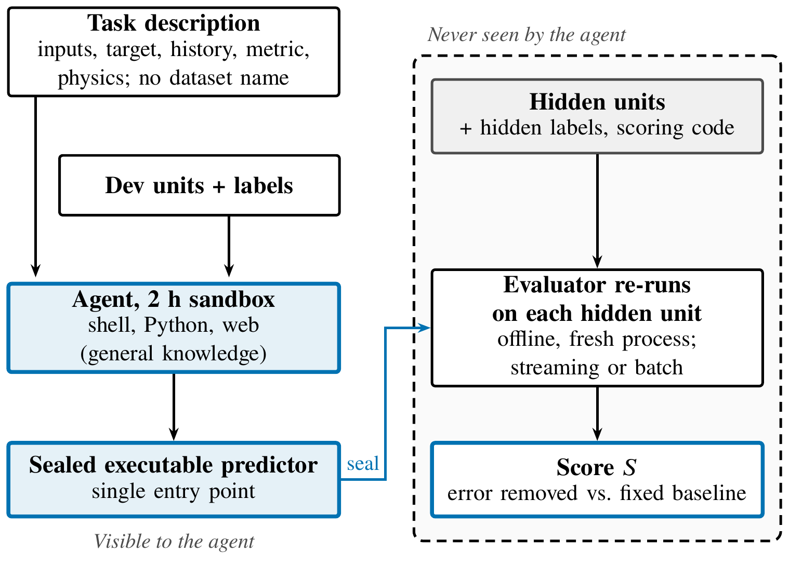

# NextUnit-Bench

### Moving Generality from Model to Modeler: LLM Agents for PHM on a Deployment-Style Benchmark

**[Zhenling Chen](https://github.com/JialingRichard)**

Laboratoire Génie Industriel, CentraleSupélec, Université Paris-Saclay

> [!NOTE]
> **The code is coming soon.** This repository will host NextUnit-Bench: the frozen benchmark definition, data acquisition, the sealed evaluator, a minimal agent runner, self-checks, and the scripts behind the paper's figures.

  

<em>
Deployment-style evaluation. The agent sees the task description and the development units, works for two hours in a sandbox, and delivers a sealed, executable predictor. The evaluator runs it offline on each hidden unit; the hidden units, their labels, the scoring code, and the score itself remain invisible to the agent.
</em>

## Abstract

Coding agents built on large language models (LLMs) now help develop many models published as general solutions. Should generality instead reside in the agent that builds a model for each new task? We examine this question in prognostics and health management (PHM), where every model must work on unseen equipment. Our deployment-style benchmark, NextUnit-Bench, covers 24 public datasets split into 58 folds that hold out units or operating conditions; each agent has two hours to deliver an executable predictor, then run on the hidden units. First, frontier agents outperform AutoML, which reaches less than half the best agent's score, and faithful implementations of published methods on four datasets, of which only 6 of 30 beat the strongest agent's own design; published accuracies, where reproducible, rest on the papers' own conventions, and a single convention, capping the remaining life of test engines, can halve the reported error. Second, the agents' advantage is a design made on each machine's data; once made, a plain-text plan of a few hundred words carries most of the gap between two frontier agents, and given a weaker agent's plan, the strongest agent falls to that agent's level, often to identical predictions. Before touching the data, however, the gap between the two shrinks to about a third, and domain toolkits appear to help neither: what sets the strongest apart is how much it learns from the data. Third, such designs reach only implementers that can execute them: given the strongest agent's designs, a locally deployable open-weight model delivers half as often, even when they are lightened, and scores no higher than without them. Generality, we argue, is not disappearing but moving, from the model to the modeler.

## At a glance

- **24 public PHM datasets, 58 folds** that hold out units or operating conditions: bearings, batteries, turbofan engines, wind turbines, process plants, and more.
- **Deployment-style protocol:** the subject works for two hours on development units only, then delivers an executable predictor that is sealed and re-run offline on the hidden units.
- **Any modeler:** LLM agents, AutoML, published methods, or your own pipeline are scored by the same evaluator.
- **Agent-facing:** the benchmark is set up by an agent following a field manual; datasets are not redistributed but fetched from their original sources and verified by checksums.

## Paper

*Moving Generality from Model to Modeler: LLM Agents for PHM on a Deployment-Style Benchmark.*
Zhenling Chen, Zhiguo Zeng, and Anne Barros. arXiv link coming soon.

## Citation

The BibTeX entry will be added once the paper is on arXiv.

## Contact

Questions and issues: please open a GitHub issue or contact Zhenling Chen.

## License

Code: [MIT](LICENSE). Benchmark definition files, documentation, and figures: CC BY 4.0. The datasets are not part of this repository and remain under their original licenses.
